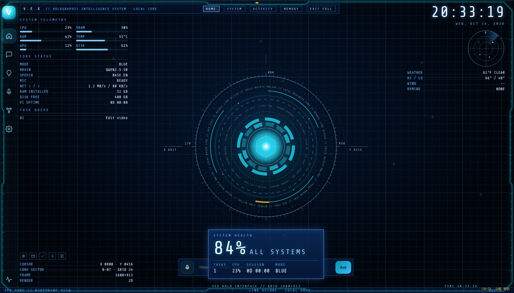
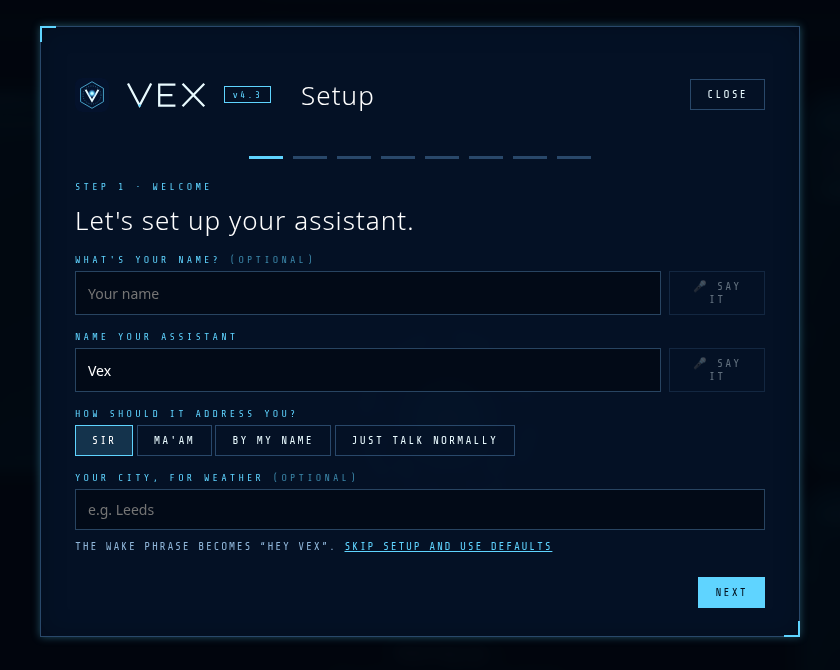
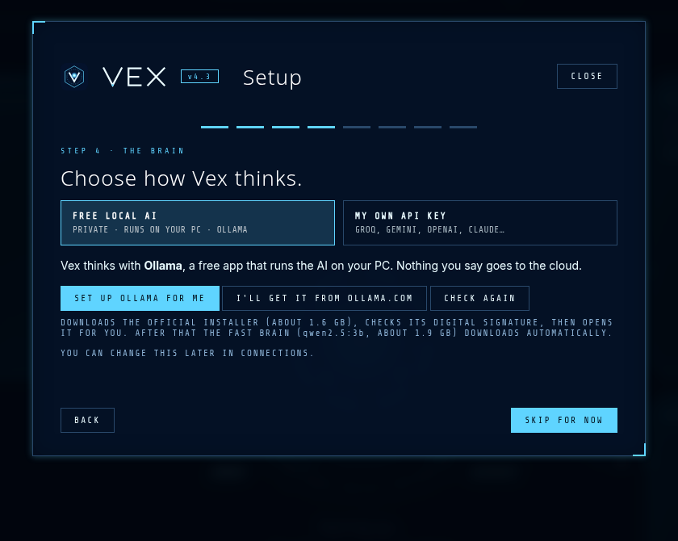
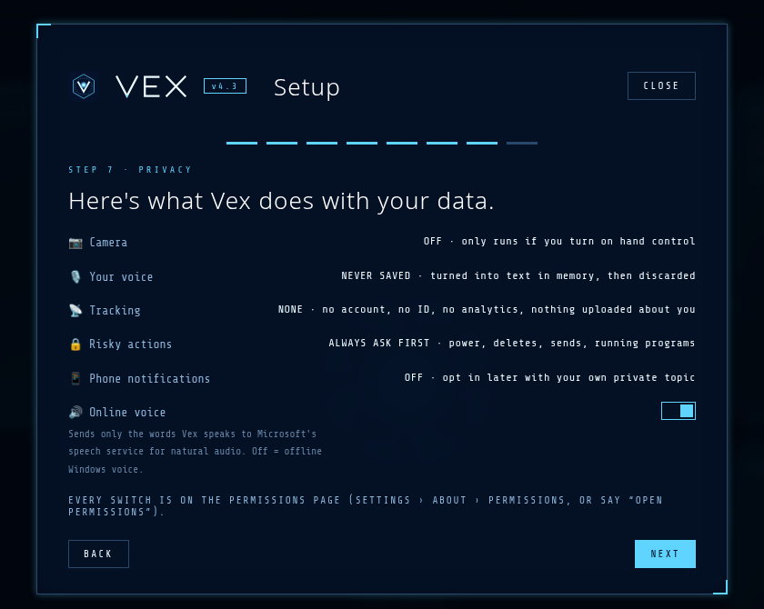

# Vex Assistant 4.3 · Public Edition

**A free, private voice assistant for Windows that runs on your own PC.**

Talk to it, type to it, let it open apps, set timers and answer questions — and it asks before doing anything risky.

<p align="center">
  
</p>

## Download

Get the Windows installer from the latest release:

**→ [Download Vex Assistant 4.3](https://github.com/lazygamer1881/vex-assistant/releases/latest)**

| File | What it is |
|------|------------|
| `VexAssistant-Setup-4.3.exe` | One-click installer (~53 MB) |
| `VexAssistant-4.3.zip` | Portable / script install (`Install.cmd`) |
| `SHA256SUMS.txt` | Checksums for the release assets |

Landing page (screenshots & FAQ): [`docs/index.html`](docs/index.html)

### Windows SmartScreen

New apps without a paid code-signing certificate show **“Windows protected your PC”**. Click **More info** → **Run anyway**. To be extra careful, compare the file’s SHA-256 with the checksums on the [Releases](https://github.com/lazygamer1881/vex-assistant/releases/latest) page:

```powershell
Get-FileHash .\VexAssistant-Setup-4.3.exe
```

## What it does

- **Talk or type** — say “hey Vex” (or any name you give it), hold Ctrl+Alt+V, or type. Answers are spoken sentence by sentence.
- **Free local brain** — runs AI on your PC with Ollama (setup can install it), or plug in your own Groq / Gemini / OpenAI / Claude / OpenRouter key.
- **Runs your PC** — opens apps and folders, snaps windows, timers, reminders, media keys, disk clean-up, screenshots and PC stats.
- **Asks first** — shutting down, deleting, sending, running programs: always “Shall I proceed?”
- **Eight original themes** — dark HUD looks with per-mode colours.
- **Private by design** — no account, no tracking, no analytics. Camera off by default. Your voice is never recorded or saved.
- **Small download** — ~53 MB. The speech engine (~240 MB) downloads on first run from official sources, checksum-verified.

### First-run setup

<p align="center">
  
  
  
</p>

1. Name your assistant (that name becomes the wake phrase) and pick how it addresses you.
2. Test your microphone and speakers.
3. Download the voice pack (~240 MB) — every file is SHA-256 checked.
4. Choose a brain: **Set up Ollama for me**, or paste your own API key.
5. Theme, skippable intro, and a plain-language privacy summary.

## Requirements

- Windows 10 or 11, 64-bit
- 8 GB RAM (16 GB or a 6 GB+ GPU for the optional big brain)
- ~0.5 GB disk for the app and voice pack, plus 2–5 GB for an AI model
- A microphone
- Internet for the first-run downloads (afterwards it works offline except web search, weather and the online voice)
- WebView2 (built into Windows 11; on older Windows 10 install the free [WebView2 Runtime](https://developer.microsoft.com/microsoft-edge/webview2/) if the window stays blank)

## Privacy

- No account, no tracking, no analytics, no hidden network calls.
- Camera is off unless you turn on hand control. Frames are never saved or sent.
- Your voice is never recorded or saved. Speech becomes text in memory and is discarded.
- Phone notifications are opt-in (your own private ntfy topic).
- The online voice sends only the words Vex says to Microsoft’s speech service. Switch to the offline Windows voice any time.
- API keys are encrypted with Windows DPAPI.
- Risky actions always ask first. Every switch is on **Settings → About → Permissions**.

## This repository

This tree is the **public app source** (Python, UI, install scripts) plus docs — **not** the bundled Windows Python runtime, speech models, or MediaPipe hand-control binaries (those ship in the release installer; see `app/vex/ui/lib/mediapipe/MEDIA_MODELS.md`).

```
app/                 Python app + UI (run_vex.pyw, vex/, requirements.txt)
Install.cmd          Zip / source installer entry point
install.ps1          Current-user install into %LOCALAPPDATA%\Programs\VexAssistant
docs/                Landing page + screenshots
LICENSE              MIT
THIRD_PARTY_LICENSES.txt
CHANGELOG.md
version.json.example
```

### Running from source (developers)

The supported way for end users is the [release installer](https://github.com/lazygamer1881/vex-assistant/releases/latest), which includes a trimmed Python 3.12 runtime. From this source tree you need your own Python 3.12+ on Windows, then:

```text
pip install -r app/requirements.txt
# optional: copy MediaPipe .task / .wasm files from a release into app/vex/ui/lib/mediapipe/
pythonw app\run_vex.pyw
```

Voice pack and Ollama are still downloaded from the in-app first-run setup when you click.

## License

MIT — see [LICENSE](LICENSE). Third-party components: [THIRD_PARTY_LICENSES.txt](THIRD_PARTY_LICENSES.txt).

Changelog: [CHANGELOG.md](CHANGELOG.md).

Not affiliated with any film, comic or game studio. Ollama, Microsoft, Windows and other names belong to their owners.
